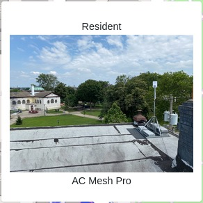
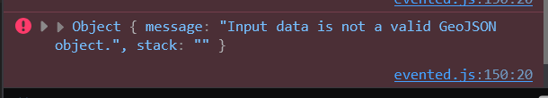

# pcwnetworkmap


This map of PCW's network coverage is built with MapBox via Jekyll.

Deploy previews via `Render`

The live deploy of the map is availabe here - https://map.phillycommunitywireless.org

# Additional functionality
## URL Parameters 
### Setting default position/zoom level
On page load, the map shows PCW's main three coverage areas - Norris Square, Fairhill, and Kensington. The `latitude`, `longitude`, and `zoom` URL parameters can be used to show a specific latitude, longitude, and zoom level at page load. 

e.g - `https://map.phillycommunitywireless.org/?latitude=39.95239&longitude=-75.16364&zoom=16` sets the default view to a zoomed-in view of Philadelphia City Hall 


## Setting menu visibility at map load 
Similarly, the `menu_closed` URL parameter sets if the menu is open or closed at map load time - e.g, `https://map.phillycommunitywireless.org/?menu_closed=true` 

# Local Development 
You can run this site locally in a container using Docker
* Clone the repo with `git clone`
* Sign up for a [MapBox developer account and get a MapBox public token]([url](https://docs.mapbox.com/help/dive-deeper/access-tokens/))
* Set `MAPBOX_API` in `_config.yml` to your MapBox public token.  
* `docker compose up -d`
* `jekyll` will serve at `localhost:4000`
* docker run --rm -v .:/app -w /app ruby:latest bundle lock

# Editing map contents
As of 8/20/24, the map **no longer uses the geosjon files in `/data`**. It is now linked to an API that generates GeoJSON files dynamically based of the content of a spreadsheet - **please contact a PCW staff member for access.**

The rest of this section is the PCW Network Map Editing Documentation (last edited 2026-03-04), moved here from PCW's shared drive.

## Overview
This section details how to edit the [PCW Network Coverage Map](https://phillycommunitywireless.github.io/pcwnetworkmap/), which shows PCW's network infrastructure.

The Google Sheet 'PCW Install Spreadsheet to GeoJson Datasource' is accessed by an API written in Go hosted on Render, which upon request reaches out to the spreadsheet, generates Points/Lines on the fly, and then returns the formatted GeoJSON object in order to ease the entry, modification, and deletion of new network nodes and relationships. Going forward, all future edits to map data will be made through this spreadsheet.

* Map Github Repository - https://github.com/phillycommunitywireless/pcwnetworkmap
  * Hosted on Github Pages - https://phillycommunitywireless.github.io/pcwnetworkmap/
* API Github Repository - https://github.com/phillycommunitywireless/pcwnetworkmap-api

## Using the spreadsheet
The Apps Script generates GeoJson files from 3 sheets:

* 'networkpoints' - all individual network 'nodes' - LiteBeams, routers, and APs
* 'level1' - connections from 'high sites' (Gotham, Jasper Studios, J-Centrel Apartments) to a LiteBeam (green lines)
* 'level2' - wired connections from LiteBeams to APs (magenta lines)
* 'level3' - mesh connections from wired APs to non-wired APs (yellow lines)

The map uses the terms 'main router' for LiteBeams, 'roof hub' for wired APs, and 'mesh node' for meshed APs.

> Note (2026-09): there is no Apps Script any more. The Go API reads the sheet directly on every request and serves five tabs, `networkpoints` and `level1` to `level4`, at `/get_networkpoints` and `/get_level1` to `/get_level4` (`main.go` and `processor.go` in pcwnetworkmap-api). The map fetches all five (`js/layers/network-layers.js`). `level4` is the point-to-point bridges (see [Level4](#level4) below). The line colours have changed too: level1 is violet, level2 solid light grey, level3 coral, level4 orchid (`js/layers/network-layers.js`). The API reads every tab from row 6 down, so rows 1 to 5 are headers only.

## Adding Images to the map
1. Create a new branch - https://github.com/phillycommunitywireless/pcwnetworkmap/branches
2. Locally or via web editor, add your photo files to the `/img/` directory in your branch
3. Commit and upload
4. Open a PR for your new branch
5. For each photo, right click > "Open image in new tab"
6. Get the direct link to the image ("raw.githubusercontent…")
7. Insert that link into the "image URL" field of the spreadsheet: PCW Install Spreadsheet to GeoJson Datasource
8. Test to ensure the image appears.



> Note (2026-09): the "image URL" field is column F, "Image", on the `networkpoints` tab. The popup shows the photo only for roof hubs (RH) and mesh nodes (MN), with the AP Type column under it (`js/map-on-mouse.js`). The link from steps 5 and 6 points at your branch or at a single commit; once the PR is merged, use the `main` form, `https://raw.githubusercontent.com/phillycommunitywireless/pcwnetworkmap/refs/heads/main/img/<file>`, so deleting the branch can't break the popup. Every photo link in the sheet was moved to that form in September 2026.

## Adding to networkpoints
### Schema Mapping
Each entry in `networkpoints` must obey this schema. Each spreadsheet column corresponds with one of these attributes.

```json
{
    "type": "Feature",
    "properties": {
        "name": "Gotham Tower",
        "id": "HS001",
        "Street address": "<street address>",
        "type": "HS",
        "image": "https://raw.githubusercontent.com/fmvaldezg/PCW_animatedlines/main/img/img1.jpg",
        "Latitude": 39.981349,
        "Longitude": -75.137339
    },
    "geometry": {
        "type": "MultiPoint",
        "coordinates": [
            [
                -75.1373393,
                39.9813486
            ]
        ]
    }
},
```

* Type - the datatype of the datapoint - will always be 'Feature'.
* Properties - information about the datapoint
  * Name: the datapoint's name - displayed on the map upon hover.
  * ID: the datapoint's ID. This consists of the type and an incrementing number.
    * E.g: Gotham is HS001, Jasper Studios is HS002…
  * Street Address: the street address of the datapoint - not displayed
  * Type: the datapoint's type. This consists of 'HS' (High Sites), 'LB' (Main Routers), 'RH' (Roof Hubs), and 'MN' (Mesh Nodes).
  * image: an image of the datapoint - currently not used, and is the same for every datapoint. Could be used in the future to show images of the network point.
  * Latitude: the datapoint's latitude - currently not used, instead the coordinates in 'Geometry' are used for placement.
  * Longitude: the datapoint's longitude - currently not used, instead the coordinates in 'Geometry' are used for placement.
* Geometry - the actual geographic information for the datapoint.
  * Type: the datapoint's type - this will always be 'MultiPoint'.
  * Coordinates: the longitude and latitude of the datapoint.

> Note (2026-09): `image` is now used: it is the popup photo (see [Adding Images to the map](#adding-images-to-the-map)). The sheet has two more columns after the geometry, L "Year" (the install year, which drives the timeline slider, `js/bind-points-visibility.js`) and M "AP Type" (the text under the name in the popup, `js/map-on-mouse.js`); "Notes (INTERNAL)" is column N. The API does not read the Street Address column, so addresses never reach the map (`processor.go` in pcwnetworkmap-api).

### Adding data to networkpoints
1. Find the coordinates of the node you want to add via address - I like this website - [Latitude and Longitude Finder](https://www.latlong.net/) - but anywhere you can find latitude/longitude will do.
2. Scroll down to the next empty row.
   * Take care to ensure there are no empty rows between existing rows; this will break the GeoJson formatting.
3. Enter the following information into each column. Ensure all fields are filled; empty cells will also break the GeoJson formatting.
   * Type - 'Feature'
   * Name - the display name of the network point - this is what will be displayed on the map on hover.
     * To protect the privacy of residents w/ nodes, instead of entering the resident's name or address, just enter "Resident".
   * ID - the network point's ID, consisting of the network point type (HS, LB, RH, or MN) and an incrementing number.
   * Street Address - the street address of the network point - this is not displayed.
   * Network Node Type - the network point's type, consisting of either HS, LB, RH, or MN.
   * Image - copy and paste from the previous row.
   * Latitude - the latitude of the datapoint.
   * Longitude - the longitude of the datapoint.
   * Geometry Type: 'MultiPoint'
   * Longitude - the longitude of the network point.
   * Latitude - the latitude of the network point.
   * Notes - any notes about the network point - not displayed, but for internal purposes.
4. View or refresh the map and verify the new network point is displaying correctly (the map icon and location are correct).

> Note (2026-09): Image can be left blank for no photo; paste the photo link there instead of copying the previous row, which would show the wrong site's photo. Fill in Year and AP Type as well (columns L and M, see the note above).

## Adding to Level1
Level1 represents the connections from high sites to LiteBeams/Main Routers.

### Schema Mapping
Each entry in `level1` must obey this schema. Each spreadsheet column corresponds with one of these attributes.

```json
{
    "type": "Feature",
    "properties": {
        "fid": 1,
        "qc_id": 0,
        "name": "Gotham Tower",
        "description": "<street address>",
        "hs_id": "00001",
        "fid_2": 1,
        "qc_id_2": 0,
        "name_2": "<destination name>",
        "description_2": null,
        "hs_id_2": "00001",
        "rt_id": "00001"
    },
    "geometry": {
        "type": "LineString",
        "coordinates": [
            [
                -75.1373393,
                39.9813486,
                0.0
            ],
            [
                -75.132650070109037,
                39.984635678901576,
                0.0
            ]
        ]
    }
},
```

* Type: the datapoint's type - this will always be 'Feature'.
* Properties - information about the datapoint/line.
  * Fid - Unknown - need to ask Felipe what this means. The value appears to be arbitrary.
  * Qc_id - Unknown - need to ask Felipe what this means. The value appears to be arbitrary.
  * Name - the name of the line's origin point (a high site)
  * Description - information about the line's origin point - currently address.
  * Hs_id - the high site's ID
  * Fid_2 - Unknown - need to ask Felipe what this means. The value appears to be arbitrary.
  * Qc_id_2 - Unknown - need to ask Felipe what this means. The value appears to be arbitrary.
  * Name_2 - the name of the line's destination (a LiteBeam/Main Router)
  * Description_2 - information about the line's destination - currently mostly null.
  * Hs_id_2 - Unknown - need to ask Felipe what this means. The value appears to be arbitrary.
  * Rt_id - Unknown - need to ask Felipe what this means. The value appears to be arbitrary.
* Geometry - the geographic information of the line.
  * Type: the datapoint's type - this will always be 'LineString'
  * Coordinates: two sets of coordinates:
    * The line's origin point (a high site)
    * The line's destination (a LiteBeam/Main Router)
    * The line's z-axis - unused, and can just enter '0'.

### Adding data to level1
1. Find the coordinates of the high site and destination node you want to add - you can use a [latitude and longitude finder](https://www.latlong.net/), but the best practice is copy/pasting coordinates from networkpoints to ensure the lines start/end exactly where the network nodes do.
2. Scroll to the next empty row - Take care to ensure there are no empty rows between existing rows; this will break the GeoJson formatting.
3. Enter the following information into each column. Ensure all fields are filled; empty cells will also break the GeoJson formatting.
   1. Type - 'Feature'
   2. Fid - 1
   3. Qc_id - 0
   4. Hs_name - the name of the high site the line starts from
   5. Description - the address of the high site.
   6. Hs_id - the id of the high site.
   7. Fid_2 - Increment from the previous fid_2 value
   8. Qc_id_2 - increment from the previous qc_id_2 value
   9. Name_2 - the name of the line's destination
   10. Description_2 - 'null', unless there is specific information about the line's destination you want to denote here.
   11. Hs_id_2 - 1
   12. Rt_id - increment from the previous rt_id value
   13. Geometry Type - 'LineString'
   14. HS Longitude - the longitude of the line's start point (a high site)
   15. HS Latitude - the latitude of the line's start point (a high site)
       * For HS longitude/latitude, copy/paste from an existing entry for Gotham, Jasper, or J-Centrel
   16. Z-axis - 0
   17. Destination Longitude - the longitude of the line's destination (a network endpoint)
   18. Destination Latitude - the latitude of the line's destination (a network endpoint)
       * Copy/paste this value from networkpoints.
   19. Z-axis - 0
   20. Notes - any notes about this line - not displayed, but for internal purposes.
4. View or refresh the map and verify the new line is displaying correctly (the line starts/ends at the correct high site and network point.)

> Note (2026-09): all four line tabs (level1 to level4) now have two more columns before Notes: T "Year" and U "line_type". Set `line_type` to the tab's name (`Level1`, `Level2`, `Level3` or `Level4`): the map only draws a line whose `line_type` is one of those four and whose Year is inside the timeline range (`js/bind-points-visibility.js`), so a line with either one blank won't show. Notes is column V.

## Adding to Level2
'Level2' represents connections from LiteBeams/"Main Routers" to wired APs/"Roof Hubs"

### Schema Mapping
Each entry in `level2` must obey this schema. Each spreadsheet column corresponds with one of these attributes.

```json
{
    "type": "Feature",
    "properties": {
        "fid": null,
        "qc_id": null,
        "name": null,
        "description": null,
        "hs_id": null,
        "rt_id": null,
        "fid_2": null,
        "qc_id_2": null,
        "name_2": null,
        "description_2": null,
        "rt_id_2": null
    },
    "geometry": {
        "type": "LineString",
        "coordinates": [
            [
                "<LB longitude>",
                "<LB latitude>",
                0.0
            ],
            [
                "<RH longitude>",
                "<RH latitude>",
                0.0
            ]
        ]
    }
},
```

* Type: The datapoint's type; this will always be 'Feature'.
* Properties: information about the datapoint/line.
  * Fid: Currently always 'null'.
  * Qc_id - Currently always 'null'.
  * Name - the name of the line's origin - currently always 'null'.
  * Description: information about the line's origin point - currently always 'null'.
  * Hs_id: Currently always 'null'.
  * Rt_id: Currently always 'null'.
  * Fid_2: Currently always 'null'.
  * Qc_id_2: Currently always 'null'.
  * Name_2: Currently always 'null'.
  * Description_2: Currently always 'null'.
  * Rt_id_2: Currently always 'null'.
* Geometry - the geographic information of the line.
  * Type: the datapoint's type - this will always be 'LineString'
  * Coordinates: two sets of coordinates:
    * The line's origin point (a main router)
    * The line's destination (a wired AP/'roof hub')
    * The line's z-axis - unused, and can just enter '0'.

### Adding data to level2
1. Find the coordinates of the high site and destination node you want to add - you can use a [latitude and longitude finder](https://www.latlong.net/), but the best practice is copy/pasting coordinates from networkpoints to ensure the lines start/end exactly where the network nodes do.
2. Scroll to the next empty row - Take care to ensure there are no empty rows between existing rows; this will break the GeoJson formatting.
3. Enter the following information into each column. Ensure all fields are filled; empty cells will also break the GeoJson formatting.
   1. Type - 'Feature'
   2. Fid, qc_id, name, description, hs_id, rt_id, fid_2, qc_id_2, name_2, description_2, rt_id_2 - 'null'.
   3. Geometry_type - 'LineString'
   4. LB_longitude - the longitude of the LiteBeam/'main router'
   5. LB_latitude - the latitude of the LiteBeam/'main router'
   6. LB_z-axis - 0
   7. RH_longitude - the longitude of the wired AP/'roof hub'
   8. RH_latitude - the latitude of the wired AP/'roof hub'
   9. RH_z-axis - 0
   10. Notes - any notes about this line - not displayed, but for internal purposes.
4. View or refresh the map and verify the new line is displaying correctly (the line starts/ends at the correct high site and network point.)

## Adding to Level3
Level3 represents the connections between wired APs/'roof hubs' to mesh nodes.

### Schema Mapping
Each entry in `level3` must obey this schema. Each spreadsheet column corresponds with one of these attributes.

```json
{
    "type": "Feature",
    "properties": {
        "fid": 1,
        "qc_id": 0,
        "name": "<roof hub name>",
        "description": null,
        "hs_id": "00001",
        "rt_id": "00001",
        "fid_2": 1,
        "qc_id_2": 0,
        "name_2": "<mesh node name>",
        "description_2": null,
        "rt_id_2": "00001"
    },
    "geometry": {
        "type": "LineString",
        "coordinates": [
            [
                "<RH longitude>",
                "<RH latitude>",
                0.0
            ],
            [
                "<MN longitude>",
                "<MN latitude>",
                0.0
            ]
        ]
    }
},
```

* Type: The datapoint's type; this will always be 'Feature'.
* Properties: information about the datapoint/line.
  * Fid - Unknown - need to ask Felipe what this means. The value appears to be arbitrary.
  * Qc_id - Unknown - need to ask Felipe what this means. The value appears to be arbitrary.
  * Name - The name of the source wired AP/'roof hub'.
  * Description - null
  * Hs_id - Unknown - need to ask Felipe what this means. The value appears to be arbitrary.
  * Rt_id - Unknown - need to ask Felipe what this means. The value appears to be arbitrary.
  * Fid_2 - Unknown - need to ask Felipe what this means. The value appears to be arbitrary.
  * Qc_id_2 - Unknown - need to ask Felipe what this means. The value appears to be arbitrary.
  * Name_2 - The name of the mesh AP meshing with the source wired AP.
  * Description_2 - null
  * Rt_id_2 - Unknown - need to ask Felipe what this means. The value appears to be arbitrary.
* Geometry - the geographic information of the line.
  * Type: the datapoint's type - this will always be 'LineString'
  * Coordinates: two sets of coordinates:
    * The line's origin point (a wired AP/'roof hub')
    * The line's destination (a mesh node)
    * The line's z-axis - unused, and can just enter '0'.

### Adding Data to level3
1. Find the coordinates of the high site and destination node you want to add - you can use a [latitude and longitude finder](https://www.latlong.net/), but the best practice is copy/pasting coordinates from networkpoints to ensure the lines start/end exactly where the network nodes do.
2. Scroll to the next empty row - Take care to ensure there are no empty rows between existing rows; this will break the GeoJson formatting.
3. Enter the following information into each column. Ensure all fields are filled; empty cells will also break the GeoJson formatting.
   1. Type - 'Feature'
   2. Fid - 1
   3. Qc_id - 1
   4. Name - The name of the source wired AP/'roof hub'
   5. Description - null
   6. Hs_id - 1
   7. Rt_id - 1
   8. Qc_id_2 - 1
   9. Name_2 - the name of the mesh AP meshing with the source wired AP.
   10. Description_2 - null
   11. Rt_id_2 - 1
   12. Geometry_type - 'LineString'.
   13. RH_longitude: longitude of the source wired AP/'roof hub'.
   14. RH_latitude - latitude of the source wired AP/'roof hub'.
   15. RH_z_axis - 0
   16. MN_longitude - longitude of the destination mesh AP
   17. MN_latitude - latitude of the destination mesh AP
   18. MN_z_axis - 0
   19. Notes - any notes about this line - not displayed, but for internal purposes.
4. View or refresh the map and verify the new line is displaying correctly (the line starts/ends at the correct high site and network point.)

> Note (2026-09): the list above skips one column: the sheet has `fid_2` (column H) between `rt_id` and `qc_id_2`. Year and line_type (columns T and U) apply here too.

## Level4
> Note (2026-09): the documentation above predates the `level4` tab. Level4 holds the point-to-point bridges, shown as "Point-to-Point Bridge" in the sidebar (`index.html`). Its columns are the same as `level2` (LB_ and RH_ coordinates, then Year, line_type `Level4`, Notes), and the API serves it at `/get_level4` (`main.go` in pcwnetworkmap-api).

## Troubleshooting
For further assistance, please contact Eugene or Felipe on Slack or via email:

* Map loads, but network points or lines don't load - check the browser console and check for an error stating - 'Input data is not a valid GeoJSON object' - this means the data is formatted wrong. Check the spreadsheet for empty cells or rows.

  

* Network points load slowly - this is an inherent issue to using the Apps Script - it does not appear to be the most performant solution.

> Note (2026-09): the Apps Script is gone (see [Using the spreadsheet](#using-the-spreadsheet)); the API on Render now reads the sheet on each of the map's five requests (`processor.go` in pcwnetworkmap-api). If the API can't load a layer, the map now shows an error banner (`js/layers/network-layers.util.js`).

## Future Improvements
Future improvements can be found as Github Issues here - https://github.com/phillycommunitywireless/pcwnetworkmap/issues
